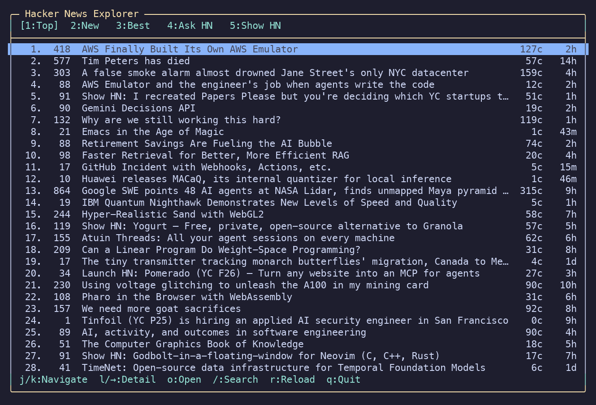

# hngleam

A keyboard-driven Hacker News reader for the terminal, written in Gleam. It
browses the Top, New, Best, Ask HN, and Show HN feeds, reads discussions, and
searches stories from the keyboard.



## Requirements

- Gleam 1.19.2 or newer
- Erlang/OTP 28 or newer (shore requires it)
- A terminal with `TERM` set. hngleam checks for a TTY and exits with a message
  rather than crashing inside the framework when there isn't one.

## Running it

```sh
gleam deps download
gleam run
```

To build a single-file escript:

```sh
gleam run -m gleescript   # produces ./hngleam
./hngleam
```

## Keys

| Key | What it does |
| --- | --- |
| `j` / `↓` | Next story or comment |
| `k` / `↑` | Previous story or comment |
| `1`–`5` | Jump to Top / New / Best / Ask HN / Show HN. This leaves a story or any level of its comments |
| `Tab` | Cycle to the next feed |
| `l` / `→` / `Enter` | Open a story, or drill into a comment's replies |
| `h` / `←` | Back one level, or back to the list |
| `o` | Open the story in your browser |
| `c` | Open the selected comment on Hacker News |
| `/` | Search Hacker News. Enter submits. Esc from a new search returns to the list; Esc while refining restores the previous results |
| `←` / `→` / `Home` / `End` / `Delete` | Move the search cursor and delete forward, while the search box is open |
| `r` | Reload the current feed, discussion, or search |
| `q` / `Esc` | Quit. While searching, Esc cancels instead: back to the list, or back to the previous results when refining a query |
| `Ctrl-C` | Quit from any screen |
| `Ctrl-X` | Emergency quit, handled by the framework |

## How it is put together

The code is a pure core with a thin effectful shell.

- `domain/` — opaque types with smart constructors: `ItemId`, `SearchQuery`,
  `Generation`, `TerminalSize`, a non-empty `Zipper`, and `Listing`.
- `decode/` — the only place untyped JSON is understood. Deleted and dead
  comments are dropped here, so the domain has no `deleted` flags. A JSON
  `null` decodes to the same default as a missing field. Story titles are
  entity-decoded; dead items and non-stories are dropped.
- `text/` — HTML to plain text (whitespace inside `<pre>` is kept), HTML
  entities, terminal-column wrapping and truncation, stripping of ANSI and
  other control characters from untrusted text, and relative timestamps. A
  missing time, stored as the unix epoch, renders as `-`.
- `api/` — URL builders, a bounded parallel map with a deadline, the comment
  tree builder, and a `Client` record of functions so tests can use fakes.
- `app/` — `Model`, `Msg`, `Action`, `Effect`, the pure `update`, and the pure
  keymap. `update` returns `#(Model, List(Effect))`, never shore closures, which
  is what makes every transition unit-testable.
- `ui/` — `layout` turns the model into a frame of pre-padded, pre-styled lines;
  `render` is a thin adapter onto shore; `viewport` is the scrolling maths.
- `platform/` — terminal size, saving and restoring the tty settings (Erlang
  FFI), and browser launching through `shellout`. Only `http` and `https` URLs
  are opened, and the URL is passed after `--`.

A feed, a comment fetch, and a search each remember the generation they
started with. A response is applied only when that request is still the one
on screen.

## Notes on the HTTP layer

`api/client.gleam` talks to the Firebase and Algolia APIs through
`src/hngleam_http.erl`. Each request connects from the calling process, so the
workers in a batch run at the same time. The socket is closed when the request
ends, including when send or receive fails, and the read shares one deadline.

## Testing

```sh
gleam format --check src test
gleam build --warnings-as-errors
gleam test
```

GitHub Actions runs those commands on pushes to `main` and on pull requests. It also builds the escript and checks that the program exits
when there is no terminal. A `v*` tag attaches that escript to a GitHub
release. Running it needs Erlang/OTP 28 or newer.

177 tests: unit tests for every domain type and text helper, decoder tests
against saved real API responses in `test/fixtures/`, parallel-map tests that
count concurrency and check that a crashed worker frees its slot, comment-tree
tests with a fake fetcher, feed classification for missing and non-story
items, and transition tests for feeds, discussions, search, and the keymap.
The HTTP parser tests call the pure response functions and do not open sockets.
`test/hngleam/ui/layout_test.gleam` holds birdie snapshots of whole screens,
recording both text and style per line. Review changed snapshots with
`gleam run -m birdie`.

Unit tests never touch the network, the terminal or the clock.

## Known limitations

- **Pasting into search does not work.** Terminals deliver a paste as one
  multi-character key and shore matches keys exactly, so the characters are
  ignored. Typing works normally. Characters outside Latin-1, including CJK,
  are not delivered as keys shore can bind, so they cannot be typed into the
  search box either.
- **Deleted and dead comments stay hidden.** A removed comment and its replies
  are dropped while the thread is built. The discussion shows comments Hacker
  News still considers live.
- **Eight colours.** shore 1.3.0 only exposes the basic ANSI palette and has no
  bold attribute, so the selected row is dark text on blue and the active feed
  tab is marked with brackets rather than a different colour.
- **Two columns of margin on the right.** shore's text node always clips to
  `width - 2`, so the frame is drawn two columns narrower than the terminal.
- **Comment budget.** A thread is fetched 50 top-level comments wide, four
  levels deep, ten replies per comment, and at most 400 comments in total. Past
  that, `c` opens the thread on Hacker News.
- Very large threads can take a few seconds to load; the screen says
  "Loading comments…" while it happens and stays responsive.

## Licence

MIT.
